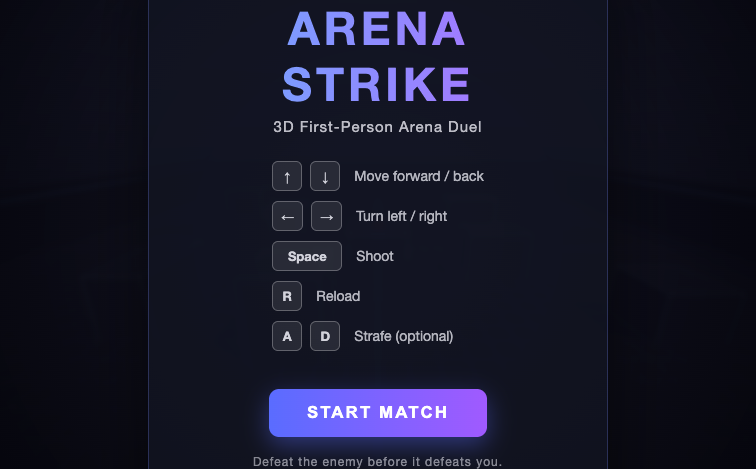
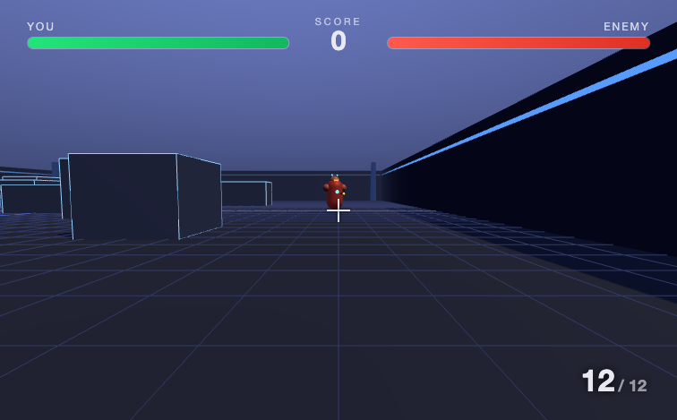
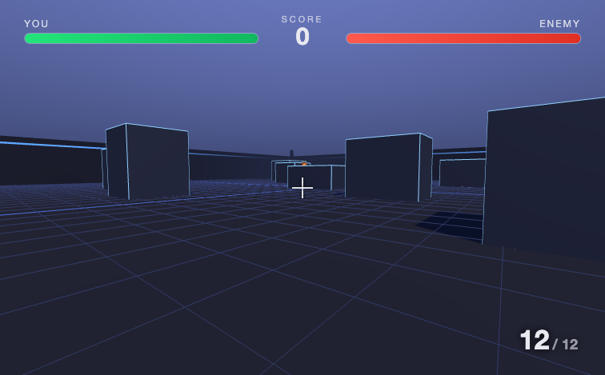

# Arena Strike

A fun little 3D first-person arena shooter that runs right in your web browser. No downloads, no installs, just open it and play.

This is a project I built to share with my 7-year-old. It's something we can play together on a game we made ourselves, which is pretty special when you think about it. You move around a 3D arena, duck behind crates for cover, and go head-to-head with a computer opponent. First one to run out of health loses.



## Built with Kiro IDE

This is really a learning project: an excuse to explore [Kiro](https://kiro.dev), an AI-powered development environment, and get a feel for building something real with AI agents. Nothing too serious, just a fun game that also happens to show what the workflow is like.

The whole game came together through conversation. I described what I wanted, a 3D first-person shooter in an arena against a computer opponent with arrow keys and spacebar to shoot, and Kiro wrote the 3D scene, the player controls, the enemy AI, the shooting, and the collision logic. The interesting part was the back and forth: when the camera moved backward instead of forward, or the shooting felt off, or the sound was getting swallowed by a sleeping audio device, each one got diagnosed and fixed through a quick exchange rather than hours of hunting through code alone. Graphics polish and sound effects were added the same way, by describing the goal and letting the agents do the work. Going from an idea to a playable, decent-looking game took a handful of prompts across an afternoon.

If you're curious about AI-assisted development, this repo is a small, honest example of what that looks like, bugs, fixes, and all.

## How to play

| Key | What it does |
| --- | --- |
| Up arrow | Move forward |
| Down arrow | Move backward |
| Left arrow | Turn left |
| Right arrow | Turn right |
| Spacebar | Shoot |
| A / D | Step left / right (strafe) |
| R | Reload your gun |

The goal is simple: hit the red robot before it hits you. Hide behind the boxes, pop out, take a shot, and duck back. Watch the health bars at the top, green is you, red is the enemy.

The arena has a gradient sky, warm lighting, glowing bullet tracers, muzzle flashes, and little spark bursts when a shot lands. There are gentle sound effects too: a soft tone when you fire and a quiet thump when something gets hit, all kept low and kid-friendly. Sound turns on the first time you click or press a key, which is just how web browsers work.

Facing off against the red robot, and a look across the arena:





## Playing it with a kid

- It's one player against the computer, so no second controller needed.
- Nothing scary, the enemy is a friendly red robot and there's no blood or gore, just glowing laser dots.
- If it feels too hard or too easy, the difficulty can be tuned. Just ask Kiro.
- When the match ends, there's a big Play Again button to jump straight back in.

## How to run it

The game needs to be opened through a tiny local web server (browsers block part of it if you just double-click the file). It's one command:

1. Open a terminal in this project folder.
2. Run:
   ```
   python3 -m http.server 8123
   ```
3. Open your web browser and go to: http://localhost:8123
4. Click START MATCH and have fun.

When you're done playing, go back to the terminal and press Ctrl + C to stop the server.

## What's inside

Three small files, nothing fancy:

- `index.html` is the page and the on-screen scoreboard, health bars, and menus.
- `style.css` is all the colors, fonts, and the look of the game.
- `game.js` is the brain of the game: the 3D arena, the player, the enemy robot, the bullets, and the rules.

It's built with [Three.js](https://threejs.org/), a popular open-source library for making 3D graphics in the browser. The library loads automatically from the internet the first time you play, so you'll want to be online.

(You won't see `.kiro/` or `.agents/` folders in this repo, they're in `.gitignore`. Those hold Kiro's local editor config and the AI agents' working files, which are specific to how the project was built, not part of the game itself.)

## A note for the grown-up

This started as a vibe-coding experiment in Kiro IDE and turned into something genuinely fun to share. Feel free to tinker, change the colors in `style.css`, make the arena bigger in `game.js` (look for the `ARENA` number near the top), or add more crates to hide behind. Even easier, open the project in Kiro and just describe the change you want. Breaking things and fixing them together is half the fun.

---

Created with [Kiro](https://kiro.dev), an AI-powered development environment.
